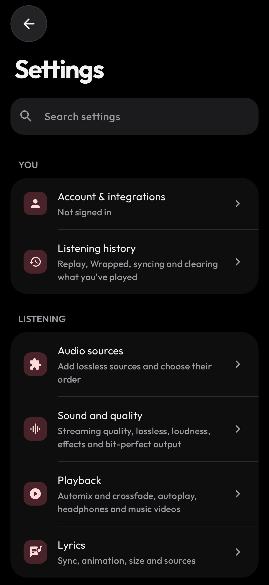

# Blynx Music

Blynx Music is a native Android player for YouTube Music and local audio, based on [OpenTune](https://github.com/justshivv/Opentune/tree/07acdf9299c0c70c9e8042ae8eceac025810cf24). The phone app uses Kotlin, Jetpack Compose and Media3. Its application ID is `vip.blynx.music`.

## Install

Open [GitHub Releases](https://github.com/updaown-hecker/Blynx-Music/releases) while signed in. Choose the ARM64 test APK for the Galaxy S25 FE and Galaxy Tab S10 Lite or the universal APK for other supported processors. Open the file on your phone and permit your browser or file manager to install it if prompted. Published test APKs carry a debug signature and a SHA-256 checksum.

On Linux x86-64, use the [Linux release](https://github.com/updaown-hecker/Blynx-Music/releases/tag/v1.1.0-linux) for Debian, RPM, and portable packages. See the [Linux setup guide](docs/blynx-linux.md) or the [Android tablet guide](docs/blynx-tablets.md).

The [web player](https://blynx-music.updaown.chatgpt.site/player/#/home) uses the packaged desktop browser extension for YouTube Music. Its [build and sync notes](web/README.md) describe the web-specific settings.

## Build

Install JDK 21 and use Android Studio's SDK Manager or `sdkmanager` to install the Android SDK packages below. Point `ANDROID_HOME` to the SDK installation.

```sh
sdkmanager 'platforms;android-37.0' 'build-tools;35.0.0' 'ndk;27.2.12479018' 'cmake;3.22.1' platform-tools
./gradlew :app:assembleDebug
./gradlew :core:testDebugUnitTest :app:testDebugUnitTest
./gradlew :app:lintDebug
```

APKs are under `app/build/outputs/apk/debug/`. The phone app targets API 36 and supports API 26 and newer. The Android CI workflow runs the build and checks. On the default branch, run **Android test release** from Actions to build, verify, and publish the two APKs for the Gradle version.

## Appearance

**Clear refraction** is the default glass style. On Android 13 and newer, floating controls with a Compose backdrop use the existing native shader lens with a shallow rim, no color film, no chromatic split, and no full-surface blur. Foreground controls are drawn over the lens. **Original liquid** retains the upstream glass, and the other upstream styles remain available. **Liquid Glass** disables refraction and **Reduce dynamic blur** uses solid surfaces. Panels in separate dialog windows use their existing frosted backdrop and solid menu surfaces.

Light, dark and system modes are available alongside OLED black, Material You wallpaper colors and optional coloring from artwork. Edit `Theme.kt` for surface colors, typography and shape tokens and `Glass.kt` for lens parameters and rim lighting. The launcher assets and in-app mark share a 108-unit viewport in `app/src/main/res/drawable/` and `LogoMark.kt`.

## Screenshot



Captured by the Android UI test suite.

## Source and integrations

The [feature checklist](docs/blynx-feature-audit.md) maps the handset features back to the upstream source. The upstream [service setup](docs/service-integrations.md) documents integrations that need owner-supplied credentials. No service credentials ship in the test build. Private GitHub releases are opened in the signed-in browser from Settings → About → Check for updates. The app has no GitHub token.

The [modification record](docs/blynx-changes.md), [GPLv3 license](LICENSE) and [third-party notices](THIRD_PARTY_NOTICES.md) accompany this derivative. Upstream companion clients and deployment configuration are retained for source continuity. Separate Android and Linux release workflows build their respective packages.
